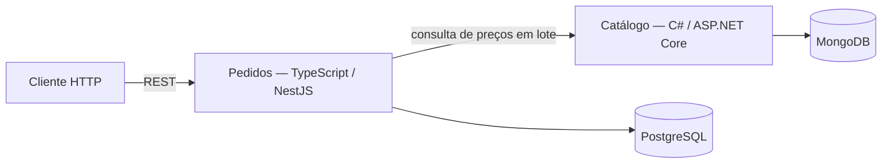

# Desafio técnico COE Leader — Pedidos e Catálogo

## Escolhas principais

O desafio foi implementado como dois serviços independentes, em um único repositório Git. Pedidos usa TypeScript, Node.js e NestJS com PostgreSQL; Catálogo usa C# e ASP.NET Core com MongoDB. Cada aplicação tem sua própria pasta, dependências, testes, build e Dockerfile. A integração entre elas acontece por HTTP REST, com contratos OpenAPI versionados em `contracts/`.

| Projeto | Stack | Responsabilidade | Persistência |
|---|---|---|---|
| `pedidos-typescript/` | TypeScript, Node.js 24, NestJS 12 | Validar e criar pedidos, consultar preços no Catálogo em lote, calcular desconto, gravar o pedido e preservar o histórico | PostgreSQL 17 |
| `catalogo-dotnet/` | C# 14, .NET 10, ASP.NET Core | Listar e consultar produtos, preços atuais e disponibilidade, inclusive em lote | MongoDB 8 |

**Por que duas linguagens?** O desafio pede dois serviços com bancos de naturezas diferentes e avalia experiência multi-stack. Usar TypeScript no fluxo de pedidos e C# no catálogo demonstra duas implementações e duas fronteiras de serviço sem introduzir uma terceira stack. Essa escolha serve ao objetivo da candidatura; não é uma necessidade de desempenho do domínio. Uma solução menor em produção poderia usar uma única stack e reduzir custo de manutenção, configuração e CI. As razões e alternativas estão no [ADR de stacks e fronteiras](docs/adr/001-stacks-e-fronteiras.md).

Pedidos é a autoridade sobre o pedido e seu histórico. Ele não recebe preço nem desconto do cliente: consulta os produtos no Catálogo, calcula em centavos inteiros e grava cabeçalho e itens na mesma transação PostgreSQL. O pedido guarda uma fotografia dos nomes, preços e regra de desconto observados; uma consulta histórica não depende de uma chamada posterior ao Catálogo.

O Catálogo é a autoridade sobre os dados e o preço atual dos produtos. Pedidos usa uma consulta HTTP em lote por criação; não acessa o MongoDB diretamente nem faz uma chamada por item. Isso mantém as fronteiras claras e evita o padrão N+1.



O escopo solicitado é de APIs. Não há uma interface de negócio separada; Swagger UI permite explorar e enviar requisições pelos navegadores. Os dois serviços também oferecem endpoints de saúde.

## Início rápido no Windows

Execute os comandos a partir da raiz deste repositório. Para rodar o sistema em containers, basta ter o Docker Desktop instalado e iniciado com suporte a Docker Compose v2; Node.js, .NET SDK e Python não precisam ser instalados no Windows para esse fluxo, pois as imagens fazem o build dos serviços. Para compilar, desenvolver e testar diretamente no host, instale Node.js 24 e .NET SDK 10. Python 3.12 é usado apenas nos validadores de documentação e contratos.

As versões exatas estão fixadas em [`pedidos-typescript/.node-version`](pedidos-typescript/.node-version), [`catalogo-dotnet/global.json`](catalogo-dotnet/global.json) e nas imagens de [`infra/compose.yaml`](infra/compose.yaml). A instalação das ferramentas de cada API é independente; não existe `package.json` nem `node_modules` na raiz.

### 0. Confirmar que o Docker está pronto

Abra o Docker Desktop e aguarde o Engine indicar que está em execução. No PowerShell, na raiz do repositório, confirme o cliente, o servidor e o Compose:

```powershell
docker version
docker compose version
```

O primeiro comando deve mostrar as versões de Client e Server. Se não conseguir conectar ao Server, aguarde a inicialização do Docker Desktop e tente novamente. O segundo deve identificar o Docker Compose v2. A primeira execução também baixa as imagens-base necessárias e pode levar alguns minutos.

### 1. Criar credenciais locais

O script gera senhas aleatórias fora do repositório, em uma pasta irmã cujo nome termina em `-local`. Ele não substitui credenciais existentes, para preservar o acesso aos volumes locais.

```powershell
$repoRoot = (Resolve-Path .).Path
$localDirectory = Join-Path (Split-Path -Parent $repoRoot) "$(Split-Path -Leaf $repoRoot)-local"
$envFile = Join-Path $localDirectory '.env'
$composeFile = Join-Path $repoRoot 'infra/compose.yaml'

if (-not (Test-Path -LiteralPath $envFile)) {
  .\infra\setup-local.ps1
}
```

`infra/.env.example` documenta as chaves de configuração, mas seus valores estão vazios. Use `infra/setup-local.ps1` para gerar uma configuração válida. Não publique nem copie o `.env` para o GitHub.

As variáveis ficam agrupadas assim; os detalhes de validação e os limites de cada configuração estão no [spec de plataforma](specs/SPEC-plataforma.md):

| Grupo | Variáveis | Finalidade |
|---|---|---|
| Portas locais | `POSTGRES_PORT`, `MONGO_PORT`, `ORDERS_PORT`, `CATALOG_PORT` | Portas publicadas em `127.0.0.1` no host |
| Senhas de bootstrap | `POSTGRES_ADMIN_PASSWORD`, `MONGO_ROOT_PASSWORD` | Criar e administrar os bancos; não usar nas APIs |
| Contas de execução/init | `ORDERS_RUNTIME_PASSWORD`, `ORDERS_MIGRATOR_PASSWORD`, `CATALOG_RUNTIME_PASSWORD`, `CATALOG_SEED_PASSWORD` | Separar permissões de aplicação, migration e seed |
| Conexões | `ORDERS_DATABASE_URL`, `ORDERS_MIGRATION_DATABASE_URL`, `ORDERS_TEST_DATABASE_URL`, `ORDERS_TEST_MIGRATION_DATABASE_URL`, `CATALOG_MONGODB_URI`, `MONGO_ADMIN_URI` | Conectar aos bancos com a conta e o escopo correspondentes |
| Catálogo e regra | `CATALOG_MONGODB_DATABASE`, `CATALOG_URL`, `DISCOUNT_ENABLED`, `DISCOUNT_RULE_ID`, `DISCOUNT_MIN_SUBTOTAL_CENTS`, `DISCOUNT_RATE_BPS` | Selecionar banco/serviço e configurar a regra de desconto |

O script gera os segredos e as URLs de conexão do Compose. Não troque o hostname `postgres`, `mongo` ou `catalog` por `localhost` dentro dos containers; esses endereços são DNS da rede Docker. A seção de execução no host explica que os hosts precisam ser adaptados aos ports publicados.

### 2. Subir os serviços e conferir o fluxo

```powershell
docker compose --env-file $envFile -f $composeFile config --quiet
docker compose --env-file $envFile -f $composeFile up -d --build --wait
node infra/smoke-system.mjs
```

O Compose aguarda os bancos, inicializa o Catálogo e aplica as migrations do PostgreSQL antes de iniciar Pedidos. O smoke executa chamadas reais às duas APIs e cria um pedido sintético; repeti-lo cria outro pedido, pois o endpoint não oferece idempotência.

Esse comando inicia o ambiente completo em segundo plano (`-d`), constrói as imagens locais (`--build`) e espera os health checks (`--wait`). Para acompanhar os logs em primeiro plano, use `docker compose --env-file $envFile -f $composeFile up --build` (sem `-d` e sem `--wait`); `Ctrl+C` interrompe os containers iniciados nesse modo.

Confira o estado e os logs:

```powershell
docker compose --env-file $envFile -f $composeFile ps
docker compose --env-file $envFile -f $composeFile logs --tail 100 orders catalog postgres mongo
Invoke-RestMethod 'http://localhost:3000/health/ready'
Invoke-RestMethod 'http://localhost:8080/health/ready'
```

### 3. Abrir documentação e APIs

| Acesso | URL |
|---|---|
| Swagger UI de Pedidos | [http://localhost:3000/docs](http://localhost:3000/docs) |
| Swagger UI do Catálogo | [http://localhost:8080/docs](http://localhost:8080/docs) |
| Saúde de Pedidos | [http://localhost:3000/health/live](http://localhost:3000/health/live) e [http://localhost:3000/health/ready](http://localhost:3000/health/ready) |
| Saúde do Catálogo | [http://localhost:8080/health/live](http://localhost:8080/health/live) e [http://localhost:8080/health/ready](http://localhost:8080/health/ready) |
| Contrato de Pedidos | [`contracts/pedidos.openapi.yaml`](contracts/pedidos.openapi.yaml) |
| Contrato do Catálogo | [`contracts/catalogo.openapi.yaml`](contracts/catalogo.openapi.yaml) |

As APIs, PostgreSQL e MongoDB publicam portas apenas em `127.0.0.1`. As portas padrão são 3000, 8080, 5432 e 27017; elas podem ser alteradas no `.env` local sem mudar as portas usadas entre containers.

Quando terminar de usar o ambiente, siga [Parar ou recriar o ambiente](#parar-ou-recriar-o-ambiente). O comando `down` encerra os containers e preserva os dados nos volumes; a remoção dos volumes é uma ação de reset e apaga os dados locais.

## Executar cada serviço

Para iniciar apenas o Catálogo com seu banco e bootstrap, execute na raiz:

```powershell
docker compose --env-file $envFile -f $composeFile up -d --build --wait catalog
```

Para iniciar Pedidos, execute:

```powershell
docker compose --env-file $envFile -f $composeFile up -d --build --wait orders
```

Pedidos depende do PostgreSQL e do Catálogo; o Compose sobe essas dependências automaticamente. Para ver os logs de uma aplicação, use `docker compose ... logs -f orders` ou `docker compose ... logs -f catalog` com os mesmos argumentos `--env-file` e `-f`.

Os comandos Compose acima são o modo recomendado e mais simples. Eles também permitem iniciar apenas o Catálogo ou apenas Pedidos (com as dependências necessárias). Para hot reload executando um processo direto no host, inicie os bancos/dependências Compose e ajuste as URLs geradas para usar as portas locais.

**Executar Catálogo diretamente no host:** primeiro suba o Mongo e aplique o bootstrap. No mesmo PowerShell em que calculou `$envFile` e `$composeFile`:

```powershell
docker compose --env-file $envFile -f $composeFile up -d --wait mongo
docker compose --env-file $envFile -f $composeFile run --rm mongo-bootstrap
$config = Get-Content -LiteralPath $envFile | ConvertFrom-StringData
$env:CATALOG_MONGODB_URI = $config.CATALOG_MONGODB_URI.Replace('@mongo:', "@127.0.0.1:$($config.MONGO_PORT)")
$env:CATALOG_MONGODB_DATABASE = $config.CATALOG_MONGODB_DATABASE
$env:ASPNETCORE_URLS = 'http://localhost:8081'
Push-Location catalogo-dotnet
dotnet restore Catalog.sln --locked-mode
dotnet run --project Catalog.Api --no-launch-profile
```

Swagger ficará em `http://localhost:8081/docs`. Para encerrar, `Ctrl+C` e `Pop-Location`.

**Executar Pedidos diretamente no host:** deixe o Catálogo Compose iniciado na porta padrão 8080 e suba também PostgreSQL. Aplique a migration usando o job oficial antes de iniciar o processo NestJS:

```powershell
docker compose --env-file $envFile -f $composeFile up -d --build --wait postgres catalog
docker compose --env-file $envFile -f $composeFile run --build --rm --no-deps orders-migrate
$config = Get-Content -LiteralPath $envFile | ConvertFrom-StringData
$env:ORDERS_PORT = '3001'
$env:ORDERS_DATABASE_URL = $config.ORDERS_DATABASE_URL.Replace('@postgres:', "@127.0.0.1:$($config.POSTGRES_PORT)")
$env:ORDERS_MIGRATION_DATABASE_URL = $config.ORDERS_MIGRATION_DATABASE_URL.Replace('@postgres:', "@127.0.0.1:$($config.POSTGRES_PORT)")
$env:CATALOG_URL = "http://localhost:$($config.CATALOG_PORT)"
$env:DISCOUNT_ENABLED = $config.DISCOUNT_ENABLED
$env:DISCOUNT_RULE_ID = $config.DISCOUNT_RULE_ID
$env:DISCOUNT_MIN_SUBTOTAL_CENTS = $config.DISCOUNT_MIN_SUBTOTAL_CENTS
$env:DISCOUNT_RATE_BPS = $config.DISCOUNT_RATE_BPS
Push-Location pedidos-typescript
npm ci
npm run start:dev
```

Swagger ficará em `http://localhost:3001/docs`. Para encerrar, `Ctrl+C` e `Pop-Location`. A configuração gerada usa `postgres`, `catalog` e `mongo` como nomes DNS, válidos dentro da rede Compose; os exemplos acima convertem somente as URLs necessárias ao processo executado no host. Execute um bloco de cada vez e mantenha as variáveis da respectiva API no PowerShell em que o processo inicia.

## Bancos, migrations e dados de demonstração

### PostgreSQL — Pedidos

Ao subir o Compose, o PostgreSQL cria os papéis e os bancos `orders` e `orders_test`; o job `orders-migrate` aplica a migration de Pedidos. Os scripts ficam em [`infra/postgres/01-roles.sql`](infra/postgres/01-roles.sql) e [`pedidos-typescript/src/migrations/sql/`](pedidos-typescript/src/migrations/sql/). O banco `orders` começa sem pedidos. O smoke e as requisições de criação adicionam pedidos sintéticos; não há seed de pedidos.

O runtime usa o papel `orders_runtime`, com acesso limitado. O job de migration usa `orders_migrator`. Os testes de integração rodam somente contra `orders_test`; [`infra/test-orders.ps1`](infra/test-orders.ps1) valida o banco de destino antes de executar.

### MongoDB — Catálogo

No primeiro início do volume, `mongo-bootstrap` cria o validador, os índices, os papéis e 24 produtos sintéticos: 23 ativos e um inativo. O processo é idempotente e insere somente produtos ausentes. Para reaplicar o seed a qualquer momento:

```powershell
.\infra\seed-demo.ps1
```

O script não apaga nem substitui produtos existentes e não cria pedidos. Os dados e preços do seed estão em [`infra/mongo/bootstrap.js`](infra/mongo/bootstrap.js). Os papéis `catalog_runtime` e `catalog_seed` separam leitura da aplicação e escrita do seed.

O cenário canônico usa o Teclado (`11111111-1111-4111-8111-111111111111`, R$ 200,00) e o Mouse (`22222222-2222-4222-8222-222222222222`, R$ 100,00). Com quantidade 2 e 1, respectivamente, o subtotal é R$ 500,00. A regra local padrão aplica 10% a partir de R$ 500,00, resultando em R$ 50,00 de desconto e R$ 450,00 de total. Os valores são enviados e persistidos como centavos inteiros.

## Exercitar os endpoints

Pedidos oferece `POST /api/v1/orders` para criar, `GET /api/v1/orders` para listar resumos paginados e `GET /api/v1/orders/{orderId}` para consultar um pedido completo. Catálogo oferece `GET /api/v1/products` para listar ativos, `GET /api/v1/products/{productId}` para consultar um produto e `POST /api/v1/products/query` para buscar de 1 a 100 produtos em lote. Ambos têm `GET /health/live` e `GET /health/ready`.

Exemplo no PowerShell, depois de subir o sistema:

```powershell
$products = Invoke-RestMethod 'http://localhost:8080/api/v1/products?page=1&pageSize=20'

$body = @{
  customer = @{ name = 'Cliente Exemplo'; email = 'cliente@example.com' }
  items = @(
    @{ productId = '11111111-1111-4111-8111-111111111111'; quantity = 2 }
    @{ productId = '22222222-2222-4222-8222-222222222222'; quantity = 1 }
  )
} | ConvertTo-Json -Depth 5

$order = Invoke-RestMethod -Method Post `
  -Uri 'http://localhost:3000/api/v1/orders' `
  -ContentType 'application/json' `
  -Body $body

Invoke-RestMethod "http://localhost:3000/api/v1/orders/$($order.id)"
Invoke-RestMethod 'http://localhost:3000/api/v1/orders?page=1&pageSize=20'
```

O corpo de criação aceita cliente e itens, não aceita preço, desconto ou status. Um produto inexistente/inativo ou falha do Catálogo impede a gravação. Erros seguem `application/problem+json` e incluem código estável e correlação. Os exemplos executáveis adicionais estão em [`pedidos-typescript/Orders.http`](pedidos-typescript/Orders.http) e [`catalogo-dotnet/Catalog.Api/Catalog.Api.http`](catalogo-dotnet/Catalog.Api/Catalog.Api.http).

## Testes e validação

### Pedidos — TypeScript/NestJS

```powershell
Push-Location pedidos-typescript
npm ci
npm run build
npm run typecheck
npm run lint
npm test
Pop-Location
```

Os testes unitários e HTTP não precisam de banco. Para testar migrations e transações com PostgreSQL real, suba o ambiente Compose e execute na raiz:

```powershell
.\infra\test-orders.ps1
```

### Catálogo — C#/ASP.NET Core

```powershell
Push-Location catalogo-dotnet
dotnet restore Catalog.sln --locked-mode
dotnet format Catalog.sln --verify-no-changes --no-restore
dotnet build Catalog.sln --configuration Release --no-restore
dotnet test Catalog.sln --configuration Release --no-build
Pop-Location
```

### Contratos, documentação e integração

Os validadores Python usam dependências de documentação fora dos projetos de aplicação e podem ser instalados em uma virtualenv na pasta local irmã:

```powershell
py -3.12 -m venv (Join-Path $localDirectory '.venv-docs')
$docsPython = Join-Path $localDirectory '.venv-docs/Scripts/python.exe'
& $docsPython -m pip install -r docs/validation/requirements-documentacao.txt
& $docsPython docs/validation/validar-especificacoes.py
```

Com os serviços Compose no ar, rode também:

```powershell
node infra/smoke-system.mjs
& $docsPython docs/validation/validar-contratos-runtime.py
```

O smoke usa as APIs e os bancos reais. A validação runtime compara requisições e respostas com os schemas OpenAPI. Para reproduzir a campanha ampliada, seus ambientes isolados, histórico e limitações, consulte [`docs/qa/README.md`](docs/qa/README.md); para consultas Mongo, índices e medições locais, consulte [`docs/evidencias/`](docs/evidencias/).

### CI no GitHub

O workflow [`.github/workflows/ci.yml`](.github/workflows/ci.yml) executa build, tipos, lint e testes de Pedidos; restore, formatação, build e testes do Catálogo; validações OpenAPI e documental; testes de integração PostgreSQL; smoke e contratos runtime das duas APIs em containers. Ele roda em pushes para `main`, `develop`, `master`, `feature/**`, `release/**` e `hotfix/**`, além de pull requests. A política documentada é aguardar os checks antes de promover uma mudança; branch protection/required checks não foram configurados, então a CI não é apresentada como bloqueio técnico de merge.

O repositório possui CI executada no GitHub. A pipeline não publica imagens nem executa deploy em nuvem: o desafio não fornece destino, credenciais ou orçamento, e a publicação real em cloud foi tratada como extensão condicional. Portanto, os checks de CI estão demonstrados, mas não há enforcement de branch protection nem deploy externo alegados. Consulte o [estado da plataforma](specs/SPEC-plataforma.md) para os limites exatos do gate.

## Organização e documentos do desafio

- [Análise ponto a ponto do PDF](docs/analise-do-desafio.md), [PRD](docs/PRD.md), [mapa de capacidades](docs/CAPABILITY-MAP.md) e [matriz de rastreabilidade](docs/matriz-de-rastreabilidade.md).
- [Specs completas](specs/README.md), [contratos OpenAPI](contracts/README.md), [arquitetura](docs/arquitetura.md) e [ADRs](docs/adr/README.md).
- [Guia multi-stack de code review (Markdown)](docs/governanca/guia-de-code-review.md) e [PDF de duas páginas](docs/output/pdf/guia-de-code-review.pdf).
- [Dimensionamento executivo](docs/proposta/dimensionamento.md), [uso de IA](docs/uso-de-ia.md) e [revisão de mensagens com IA](docs/ia/revisao-validacoes-mensagens.md).
- [QA e evidências](docs/qa/README.md), [reprodução em setup limpo](docs/evidencias/setup-limpo.md), [execuções hospedadas de CI](docs/evidencias/ci-hospedada.md), [revisão documental](docs/revisao-das-especificacoes.md) e [backlog](docs/tasks/todo.md).
- [Fluxo Git](docs/fluxo-git.md), [checklist de submissão](docs/entrega/checklist-submissao.md) e [roteiro/slides de 6–7 minutos](docs/apresentacao/README.md) ([PowerPoint](docs/apresentacao/desafio-tecnico-coe-leader-final.pptx)).

## Critérios avaliados e evidências

| Critério do desafio | Onde conferir |
|---|---|
| Qualidade do código | Projetos independentes, parametrização SQL, validação, limites, testes e [guia de review](docs/governanca/guia-de-code-review.md) |
| Funcionalidade dos dois serviços | Smoke ponta a ponta, integração PostgreSQL e contratos runtime em [`docs/qa/`](docs/qa/) e [`docs/evidencias/`](docs/evidencias/) |
| Documentação do setup, configuração, uso e prompts | Este README e [`docs/uso-de-ia.md`](docs/uso-de-ia.md) |
| Git e GitHub com commits, branches e pull requests | [Fluxo Git](docs/fluxo-git.md), histórico, template, [PR #1 integrado de `feature/readme-delivery` para `develop`](https://github.com/EricoCalasans/DesafioStefanini/pull/1) e [GitHub Actions](https://github.com/EricoCalasans/DesafioStefanini/actions); não houve revisão independente por outra pessoa |
| Implementação dos diferenciais | [Revisão de mensagens](docs/ia/revisao-validacoes-mensagens.md), [CI](.github/workflows/ci.yml), [guia de governança](docs/governanca/guia-de-code-review.md) e [dimensionamento](docs/proposta/dimensionamento.md) |
| Uso eficaz de IA ao longo do ciclo | [Registro de IA](docs/uso-de-ia.md), specs, decisões, testes, validações e [link público da conversa](https://chatgpt.com/s/cx_6adace2a8af48191a86a6f1c7ebc73f6); acesso externo precisa ser confirmado |
| Liderança técnica e comunicação | [Guia](docs/governanca/guia-de-code-review.md), [ADRs](docs/adr/README.md), [resumo executivo](docs/proposta/dimensionamento.md) e [slides](docs/apresentacao/README.md) |

A [matriz](docs/matriz-de-rastreabilidade.md) liga os 53 pontos identificados no PDF a specs, critérios de aceite e evidências. Esse total inclui competências e critérios repetidos; não representa 53 funcionalidades.

## Limites e pontos de atenção

- Os dados são sintéticos e a execução de referência é local. O Catálogo tem 24 produtos de demonstração; Pedidos não vem com pedidos pré-carregados.
- O núcleo não inclui frontend de negócio, autenticação de usuários, CRUD administrativo do catálogo, estoque, pagamento, frete, cancelamento, multi-moeda ou idempotência do POST. A API não deve ser exposta publicamente com dados reais sem nova especificação de identidade e autorização.
- Pedidos usa o preço retornado pelo Catálogo no momento da criação e registra uma fotografia no pedido. Não há reserva distribuída de preço/estoque.
- A chamada de criação não é idempotente. Repetir um POST pode gerar outro pedido; não há retry automático após resultado ambíguo de rede.
- A revisão da IA foi validada por testes e evidências locais; ela não substitui revisão independente nem representa aprovação da banca. O uso de SAI APP 3.0 só deve ser declarado se houver evidência real de acesso e uso.
- Não publique o PDF confidencial recebido para o desafio, `.env`, credenciais, dados reais ou caches locais. A pasta `desafio-local` é ignorada e fica fora do repositório.

## Parar ou recriar o ambiente

Para parar os containers e manter os dados:

```powershell
docker compose --env-file $envFile -f $composeFile down
```

Para apagar os bancos e começar de novo, use `down --volumes` e depois faça novo `up`. **Isso apaga todos os pedidos e produtos locais**; não é necessário para uso normal.

Se uma porta estiver ocupada, altere `POSTGRES_PORT`, `MONGO_PORT`, `ORDERS_PORT` ou `CATALOG_PORT` no `.env` local e recrie os containers. Se o ambiente não ficar saudável, confira `ps` e `logs`; se a migration falhar, verifique o PostgreSQL e o job `orders-migrate`; se Pedidos não criar um pedido, confira `http://localhost:8080/health/ready` e os logs sanitizados.
