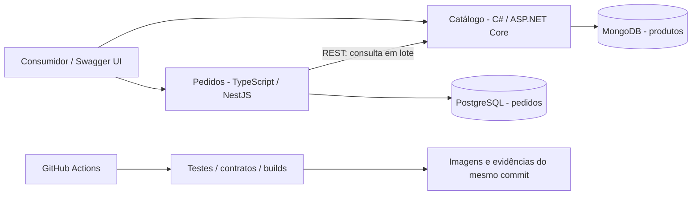

# Arquitetura proposta

**Status:** especificada, sem implementação. **Data:** 21/10/2026.

## 1. Escolhas e justificativas

| Decisão | Motivo | Custo / alternativa |
|---|---|---|
| Monorepo com dois serviços | Facilita reproduzir integração, contratos e entrega de um único desafio | Não compartilhar domínio nem bancos; separar repositórios seria possível em escala organizacional |
| Pedidos em TypeScript/NestJS | Tipagem, injeção de dependência e adaptadores organizados; boa legibilidade de casos de uso | Framework fica na borda; usar TS em ambos os serviços reduziria custo se o prazo exigir revisão |
| Catálogo em C#/ASP.NET Core | Demonstra segunda stack mantendo um serviço pequeno e contratos simples | Requer SDK e testes próprios; duas stacks são escolha, não exigência do PDF |
| PostgreSQL com `pg` | SQL parametrizado explícito e controle claro de transação | Mais mapeamento manual que ORM, aceitável para duas tabelas de negócio |
| MongoDB com driver oficial | Documentos de produto e busca em lote indexada | Seed e índices precisam de versionamento; não substituir por coleção em memória |
| REST síncrono | O consumidor precisa validar preço antes de confirmar pedido | Disponibilidade de criação depende do Catálogo; timeout e erro explícitos |
| Dinheiro em centavos e cálculo `bigint` | Evita perda de precisão e especifica arredondamento | Conversão controlada para JSON e drivers |
| Docker Compose | Um caminho comum para Windows e CI Linux | Exige Docker funcional e recursos locais |
| OpenAPI 3.1 versionado | Contrato prévio, exemplos e testes de compatibilidade | Não confiar apenas em documentação gerada de controllers |

## 2. Contexto e contêineres



Somente Catálogo acessa MongoDB e somente Pedidos acessa PostgreSQL. A dependência em execução é unidirecional. Pedidos existentes podem ser lidos sem Catálogo; criação exige o fornecedor.

## 3. Fluxo de criação

```mermaid
sequenceDiagram
    participant C as Consumidor
    participant P as Pedidos
    participant K as Catálogo
    participant M as MongoDB
    participant S as PostgreSQL
    C->>P: POST /api/v1/orders (cliente e itens)
    P->>P: Validar e capturar a política de desconto
    P->>K: POST /api/v1/products/query (IDs distintos)
    K->>M: Uma busca com filtro In sobre _id
    M-->>K: Produtos encontrados
    K-->>P: Produtos + IDs ausentes + instante
    P->>P: Validar resposta, produtos e calcular centavos
    P->>S: BEGIN; cabeçalho + lote de itens; COMMIT
    S-->>P: Pedido persistido
    P-->>C: 201 + Location + pedido completo
```

Chamada HTTP ocorre **antes de abrir a transação SQL**. Não manter conexão transacional enquanto aguarda rede. A transação protege cabeçalho/itens; não é uma transação distribuída com MongoDB. O preço contratado é o observado na consulta, não uma garantia de que não mudou até o commit.

## 4. Limites de domínio e aplicação

Pedidos: `Order`, `OrderItem`, `Money`, `DiscountPolicy`, regras de limite e erros de negócio. Casos de uso: `CreateOrder`, `ListOrders`, `GetOrder`. Portas: `ProductCatalog`, `OrderRepository`, `UnitOfWork`, `Clock` e `IdGenerator`. O repositório pode encapsular `UnitOfWork` se a operação atômica for `save(order)`; não criar as duas abstrações sem necessidade.

Catálogo: produto/preço, elegibilidade básica e limites de consulta; casos de uso de leitura; porta `ProductRepository`; adaptador MongoDB. Um projeto de domínio pequeno é suficiente, sem frameworks no domínio.

Cada aplicação compõe seus adaptadores no ponto de entrada. DTOs HTTP, atributos ASP.NET, controllers Nest e modelos de banco não atravessam as fronteiras internas. Não criar biblioteca compartilhada de entidades entre C# e TypeScript. O contrato HTTP é a interface compartilhada.

## 5. Estrutura futura

```text
apps/
  orders/
    src/domain/                 # valores, entidades, regras puras
    src/application/            # casos de uso e portas
    src/adapters/http/          # NestJS, validação e Problem Details
    src/adapters/postgres/      # SQL, transação e mapeamento
    src/adapters/catalog/       # cliente HTTP e validação do fornecedor
    src/bootstrap/              # config e composição
    migrations/                # SQL versionado
    test/unit/ test/integration/
  catalog/
    Catalog.Domain/
    Catalog.Application/
    Catalog.Infrastructure/     # MongoDB e configuração
    Catalog.Api/                # endpoints e composição
    Catalog.Tests.Unit/
    Catalog.Tests.Integration/
contracts/                     # fonte de verdade OpenAPI
tests/system/                  # dois processos e dois bancos reais
tests/performance/             # lote e experimento de carga
scripts/                       # smoke, seed, validação documental
docs/adr/                      # razões, alternativas, consequências
docs/ia/                       # prompts, resultados e validação reais
docs/evidencias/                # logs e relatórios do commit
specs/ tasks/                  # SDD e backlog
infra/                         # Compose e caminho condicional de cloud
.github/workflows/             # CI e deploy condicionado
```

Arquivos e projetos serão criados apenas na etapa de implementação. A estrutura é um contrato proposto, não um inventário de arquivos já existentes.

## 6. Convenções de código

Identificadores de código e JSON em inglês; documentação em português. TypeScript com `strict`, ESM, `camelCase` para variáveis e `PascalCase` para tipos. C# com nullable habilitado, tipos públicos `PascalCase`, métodos assíncronos terminados em `Async`. Nomes SQL em `snake_case`. Datas ISO 8601 UTC. Sem `any` para contornar resposta externa desconhecida; validar `unknown` antes de mapear.

Exemplo da regra monetária proposta, independente de framework:

```ts
type DiscountPolicy = Readonly<{
  enabled: boolean;
  thresholdCents: bigint;
  rateBps: bigint;
}>;

export function calculateDiscount(
  subtotalCents: bigint,
  policy: DiscountPolicy,
): bigint {
  if (!policy.enabled || subtotalCents < policy.thresholdCents) return 0n;
  return (subtotalCents * policy.rateBps + 5_000n) / 10_000n;
}
```

O construtor/validador da política garante domínio não negativo e taxa entre 0 e 10.000 antes desta função. A API converte `bigint` em número somente após verificar os limites documentados; `JSON.stringify` não recebe `bigint` diretamente. Testes usam resultados calculados independentemente do código de produção.

## 7. Segurança, disponibilidade e operação

APIs locais para avaliação, com dados sintéticos. Bancos sem publicação externa por padrão; credenciais de runtime com menor privilégio e papel separado de migração. Sem concatenação de valores SQL nem entrada JSON usada como filtro MongoDB. Cabeçalhos de erro e logs não incluem stack trace ou dados pessoais. Swagger UI é ferramenta de demonstração; não fornece autenticação de negócio.

Liveness verifica processo. Readiness verifica dependências locais essenciais de cada serviço: PostgreSQL para Pedidos e MongoDB para Catálogo. A disponibilidade remota do Catálogo aparece no diagnóstico e nas métricas de falha, sem impedir a leitura de pedidos por uma readiness global em cascata. O POST ainda devolve 503/504 se o fornecedor falhar.

Não haverá retries automáticos de POST de pedido. A consulta em lote ao Catálogo é de leitura, mas o núcleo também usa uma única tentativa para simplificar prazo e orçamento. Cancelar a chamada quando o orçamento expirar e propagar cancelamento até o driver do Catálogo.

## 8. Escopo da nuvem

CI e imagens fazem parte do plano. Azure Container Apps, PostgreSQL gerenciado e MongoDB Atlas constituem um caminho proposto de hospedagem, **condicional e não provisionado**. A escolha de região, plano, rede, secrets, orçamento e identidade antecede qualquer execução real. Se essa extensão não ocorrer, documentar explicitamente e demonstrar localmente o fluxo e o gate.

## 9. Limites para futuras mudanças

- Sempre: manter contrato, limites e evidência coerentes; atualizar spec antes de mudar comportamento; validar entrada e rodar os checks apropriados.
- Exigir nova decisão do candidato: substituir stack, alterar regra de negócio, acrescentar dados reais/autenticação, aceitar custo de cloud ou publicar a conversa. São mudanças materiais ou ações externas além da documentação atual.
- Nunca: inventar testes/evidências, versionar segredos, declarar uso do SAI sem acesso, ocultar requisito não atendido ou mudar histórico para simular GitFlow.

Não será criada uma solicitação de aprovação para cada arquivo, dependência ou migration necessária ao escopo quando a implementação for autorizada.
